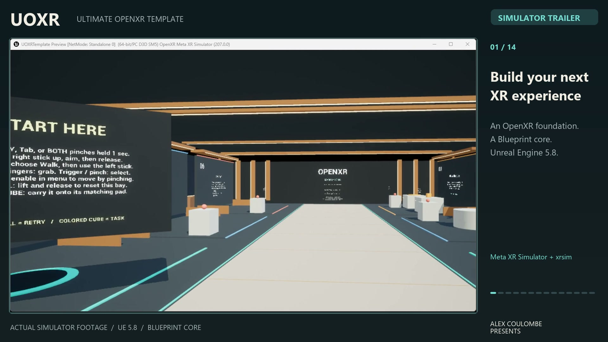
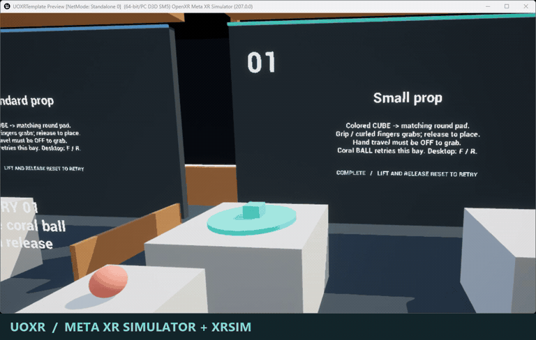
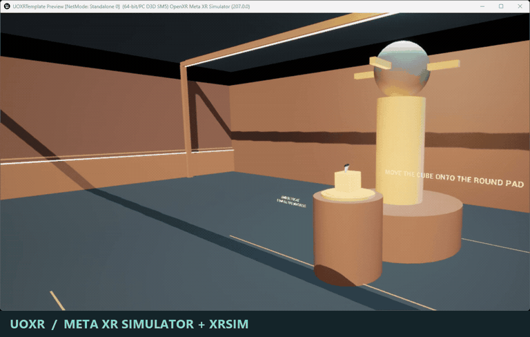
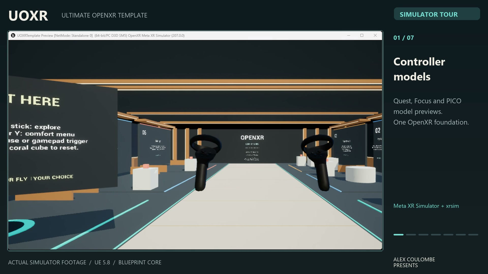

# UOXR Preview

Try the Ultimate OpenXR Template by **Alex Coulombe Presents** in your Android
headset. This repository distributes the playable demo, screenshots and test
notes. The Unreal project and template source remain private.

**[Download the preview APK](https://github.com/ibrews/uoxr-demo/releases/tag/preview-2026-10-18)**
· [Project page and simulator videos](https://alexcoulombepresents.com/lab/ultimate-openxr-template)

## Quickstart

1. Download `UOXR-Android-VR-Preview-build10-2026-10-18.apk` from the release assets.
2. Enable your headset's developer mode and install with its sideloading tool.
   If you use Android platform tools: `adb install -r UOXR-Android-VR-Preview-build10-2026-10-18.apk`.
3. Launch **UOXR Template** from your headset's applications/unknown-sources list.
   The separate application ID, `com.alexcoulombepresents.uoxrdemo`, preserves
   existing UOXR Template installations.
4. Open settings with **B/Y** on a controller, or hold **both thumb–index pinches
   for one second**, then release. Aim a ray and pinch once to select a button.
   Keyboard: **Tab**. Gamepad: **Start**.

This is a development-signed evaluation preview for Android OpenXR headsets, using
arm64, Vulkan and ASTC, with Android 12L/API 32 or newer required for build10.
It is not a phone app or a store-certified release. An APK
cannot run on PCVR or Apple Vision Pro. Compatibility on untested headsets remains
unknown; include your model and OS version when reporting a problem.

## Things to Try

1. Walk through the **Tutorial** and complete its six guided exercises.
2. Open settings and try **Teleport**, **Walk**, **Fly**, snap turning and the
   **Light/Strong comfort tunnel**. The tunnel appears during continuous movement
   and clears at rest or while the menu is open.
3. Choose **Power puzzle** at the bottom of settings. Put the teal power cell in
   its socket, pass through the door and power the machine with the amber cell.
4. Visit **Grab lab** and **Door lab** from the same menu. Lift a coral reset ball
   about a handspan and release to retry; watch for the armed prompt. Task cubes
   remain separate props. Selecting a room restarts it; comfort settings persist.
5. Swap between tracked hands and controllers. Core uses joint-based hand visuals;
   optional runtime mesh-hand plugins are not included in this preview.

## Quality and validation

The app chooses a starting quality profile automatically: Quest 3/3S 100%, Quest
Pro 90%, Quest 2/PICO 85%, and a generic Android XR fallback 80% eye render scale.
All start with 4x MSAA. Shadow budgets vary by profile. These are starting presets,
not continuous thermal/FPS adaptation or frame-rate guarantees. ASW is off by
default; earlier experimental headset results do not certify this APK.

Build10 repairs joint-only hand grip, controller flight descent, menu focus and
pointer ownership. Native simulated controller42, hand grip16/menu21, Slate
gamepad9, Windows keyboard/mouse17, lab interactions32, reset contracts68 and
profile contracts13 pass across the documented candidate progression. Native
and desktop reports retain their tested source revisions.

The exact installed build10 APK passes16 cold Android OS virtual-gamepad checks,
including D-pad/A menu selection and both flight directions. Separate actual-window
footage shows readable menus and a clear gallery after closing in PICO Emulator0.13.
Its emulator-only profile enables OpenXR layer emulation automatically, retaining
Vulkan and existing physical-device profiles. See the release for proof and hashes.
The emulator logs a Vulkan PSO-cache-save warning. Simulated input does not certify
physical controllers or tracking quality; physical fit, haptics, stereo comfort
and sustained headset performance remain pending. Packaging reuses the maintainer's
accepted launcher and does not prove clean-buyer compiler-free packaging.
**VIVE Focus3/API29 is not supported by this API32 APK.**

The [earlier build3 preview](https://github.com/ibrews/uoxr-demo/releases/tag/preview-2026-10-12)
and its original evidence remain available.

## Full feature trailer — 1m 52s

Hands, controllers, comfort, walking, flight, teleport and dash. Grab and place
physics props, retry with a coral reset ball, open doors and power a complete
workshop puzzle. Four sample rooms, desktop input and a final Android emulator
shot, recorded at normal speed with simulator labels and window chrome visible.

- [Landscape 1080p](https://github.com/ibrews/uoxr-demo/releases/download/media-2026-10-18/UOXR-Feature-Trailer-landscape-2026-10-18.mp4)
- [Portrait 1080×1920](https://github.com/ibrews/uoxr-demo/releases/download/media-2026-10-18/UOXR-Feature-Trailer-portrait-2026-10-18.mp4)
- [Five GIFs, posters, chapter captions, social copy and hashes](https://github.com/ibrews/uoxr-demo/releases/tag/media-2026-10-18)

This is footage from the QA progression, including reset balls and input repairs.
Per-shot provenance is retained; not every shot comes from the final build10 APK.
These recordings do not certify physical-headset compatibility or sustained mobile
performance. Source remains private.

## Earlier 59-second walkthrough

Hands, controller models, comfort menus, flight, teleport, grabbing, doors and a
complete power puzzle, recorded in Meta XR Simulator and xrsim. The final shot
shows the packaged APK in PICO Emulator. Simulator windows and labels stay visible.
The source remains private.

- [Watch/download landscape](https://github.com/ibrews/uoxr-demo/releases/download/preview-2026-10-12/UOXR-Simulator-Walkthrough-landscape-2026-10-12.mp4)
- [Watch/download portrait](https://github.com/ibrews/uoxr-demo/releases/download/preview-2026-10-12/UOXR-Simulator-Walkthrough-portrait-2026-10-12.mp4)
- [Captions and suggested social caption](https://github.com/ibrews/uoxr-demo/releases/tag/preview-2026-10-12) are included in the release.

Model previews show Quest/Focus/PICO appearances in Meta runtime, rather than
claiming physical tests of those devices. The video has original music and
burned-in captions; gameplay audio and haptic feel were not captured.

## Feedback

Open an issue with your headset, OS, preview version, reproduction steps and any
screenshots. For a performance report, include whether the app was warm and which
room you visited. Please do not include account credentials or private logs.

© 2026 Alex Coulombe Presents. Downloading the demo does not grant access to or a
license for the private template source.
