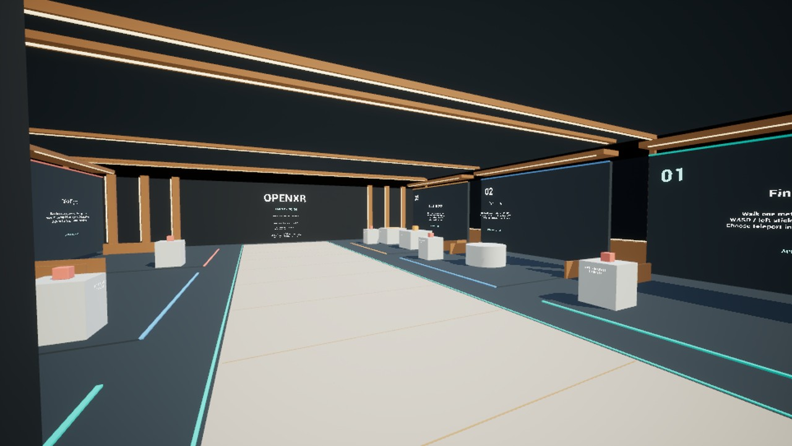
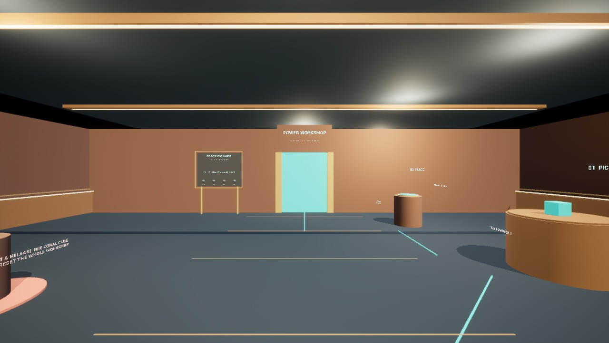

# UOXR Preview

Try the Ultimate OpenXR Template by **Alex Coulombe Presents** in your Android
headset. This repository distributes the playable demo, screenshots and test
notes. The Unreal project and template source remain private.

**[Download the preview APK](https://github.com/ibrews/uoxr-demo/releases/tag/preview-2026-10-10)**
· [Project page and simulator videos](https://alexcoulombepresents.com/lab/ultimate-openxr-template)

## Quickstart

1. Download `UOXR-Preview-Android.apk` from the release assets.
2. Enable your headset's developer mode and install with its sideloading tool.
   If you use Android platform tools: `adb install -r UOXR-Preview-Android.apk`.
3. Launch **UOXR Preview** from your headset's applications/unknown-sources list.
   The separate application ID, `com.alexcoulombepresents.uoxrdemo`, preserves
   existing UOXR Template installations.
4. Open settings with **B/Y** on a controller, or hold **both thumb–index pinches
   for one second**, then release. Aim a ray and pinch once to select a button.
   Keyboard: **Tab**. Gamepad: **Start**.

This is a development-signed evaluation preview for Android OpenXR headsets, using
arm64, Vulkan and ASTC, with Android 12L/API 32 or newer required for build 1.
It is not a phone app or a store-certified release. An APK
cannot run on PCVR or Apple Vision Pro. Compatibility on untested headsets remains
unknown; include your model and OS version when reporting a problem.

## Things to Try

1. Walk through the **Tutorial** and complete its six guided exercises.
2. Open settings and try **Teleport**, **Walk**, **Fly**, snap turning and the
   **Light/Strong comfort tunnel**. The tunnel appears during continuous movement
   and clears at rest or while the menu is open.
3. Choose **Power puzzle** at the bottom of settings. Put the teal power cell in
   its socket, pass through the door and power the machine with the amber cell.
4. Visit **Grab lab** and **Door lab** from the same menu. Lift a coral reset cube
   to repeat an exercise. Selecting a room restarts it; comfort settings persist.
5. Swap between tracked hands and controllers. Core uses joint-based hand visuals;
   optional runtime mesh-hand plugins are not included in this preview.

## Quality and validation

The app chooses a starting quality profile automatically: Quest 3/3S 100%, Quest
Pro 90%, Quest 2/PICO 85%, and a generic Android XR fallback 80% eye render scale.
All start with 4x MSAA. Shadow budgets vary by profile. These are starting presets,
not continuous thermal/FPS adaptation or frame-rate guarantees. ASW is off by
default; earlier experimental headset results do not certify this APK.

Before packaging, the source passed tutorial 17, Workshop 18, hand-menu 18 and
profile-selection 12 checks. xrsim with Meta XR Simulator 207 also drove hand
pinches through all four map destinations. Stereo captures exercised 80%/2x MSAA,
85%/4x and 100%/4x quality budgets. Simulator checks establish rendering and input
behavior on the host, not standalone headset performance. Exact-APK checks and
known limitations are listed in each release.

Build 1's exact APK was installed by SHA-256 and rendered the tutorial in PICO
Emulator 0.13. Physical Quest, PICO and Android XR acceptance of this new build is
pending. **VIVE Focus 3 is not supported by build 1:** its current firmware runs
Android 10/API 29. A separate compatibility experiment installs there but fails
the visual check, so it is not distributed here.

## Feedback

Open an issue with your headset, OS, preview version, reproduction steps and any
screenshots. For a performance report, include whether the app was warm and which
room you visited. Please do not include account credentials or private logs.

© 2026 Alex Coulombe Presents. Downloading the demo does not grant access to or a
license for the private template source.
